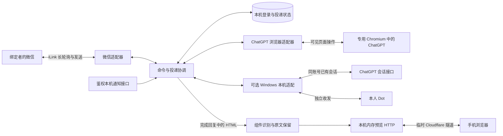

# 架构与扩展边界

项目将微信协议、消息处理状态与聊天适配分开。默认网页模式不依赖 Dot 或 Codex；可选 Windows 本机模式使用安装者自己的 Codex 登录和个人 Dot。两种模式均不需要私人回调隧道或公网 webhook。

## 模块职责

| 模块 | 职责 | 不能承担的职责 |
| --- | --- | --- |
| 微信适配器 | 扫码登录、校验绑定、长轮询、文字发送 | 按正文指定收件人、向其他联系人群发 |
| 命令与投递协调 | 区分命令和正文、选定会话、串行投递、持久记录状态 | 将输入中的普通文字当作管理权限 |
| ChatGPT 浏览器适配器 | 校验网页地址、保护草稿、提交一次、等待可确认的完成回复 | 处理验证码、复用个人主浏览器目录、使用隐蔽后台接口 |
| 可选本机适配器 | 验证登录账号、普通 GPT 会话、个人 Dot 房间，提交一次并只读确认 | 复制维护者身份、改投其他账号、未经确认创建新会话 |
| 本机状态 | 保存登录、选定会话、轮询与投递进度 | 作为可公开共享的调试附件 |
| HTML 预览 | 只替换完整组件范围、保留原文、提供隔离框架和临时访问链接 | 修改普通文字、公开本机目录、阻断正常文字回复 |

微信收发参考 [Tencent iLink Bot 协议](https://github.com/Tencent/openclaw-weixin/blob/main/docs/protocol.md)。ChatGPT 适配使用 Playwright 的[独立持久浏览器上下文](https://playwright.dev/docs/api/class-browsertype#browser-type-launch-persistent-context)，由用户自行登录。

## 一条消息的处理过程

1. 接收微信服务的更新，只接受扫码绑定者的完整单聊文字。
2. 通过原始消息标识检查重复投递。命令只匹配完整单行输入。
3. 在产生外部发送副作用之前持久记录投递意图。
4. 校验当前网页会话、空闲状态和输入框草稿，提交一次。
5. 确认新用户消息，再等待对应的新回复完成。历史回复不能作为本次结果。
6. 保存原始回复。普通文字原样回传；完整 HTML 组件替换为临时网页链接后走同一微信发送流程，外部发送结果未知时不自动重发。生成的链接不会被字节分段截断。

这些步骤旨在减少重复和错误关联，不构成“恰好一次”保证。网络断开或进程在临界点退出时，远端可能已接收消息而本地尚未获得确认。不确定状态只记录在原消息上，不自动重发；后续消息仍须通过网页会话、登录、空闲和草稿检查。进程重启会把未完成的提交保留为不确定记录，旧版的全局暂停字段会被移除，原投递记录不会删除。

## 功能范围

微信命令与已使用的 GPT 续聊范围对齐：`/help`、`/where`、`/list`、`/cd`，保留 `/switch` 兼容别名。列表最多 12 项；反复选择同一会话不重复导航。桥只接入已有普通会话，首页仅用于首次登录，不接受消息提交。

独立发行版保留默认网页模式，并提供可选 Windows 本机模式：在当前登录账号下读取普通 GPT 会话、最近列表及个人 Dot 房间。默认入口 `/cd gpt`、可选 `/cd dot`、独立主动提醒与本机 notify 均共用相同的去重与投递链路。安装者自行设置账号和会话；公开代码没有私人部署配置，不需要开启已有浏览器调试。完整范围见[功能对齐清单](feature-parity.md)。

GPT 完成回复、Dot 最终文本和本机主动通知可进行 HTML 转换，命令回复不进入发布流程。识别层利用原文偏移定位范围，保护 Markdown 行内代码、非 HTML 代码块、引用标记和未完成组件；完整原文始终可下载。HTML 服务不读取磁盘文件。页面最多 128 个、32 MiB，访问令牌每页独立生成，停止时清空。

隧道安装使用固定版本及公开校验和，工具放在用户数据目录；运行时使用独立空配置、随机回环端口和受限环境变量。只有收到域名和连接注册事件后才生成公共链接。安装/启动失败以及格式化异常均回退原文，不能改变既有微信去重与不重发语义。

## 为什么第一版没有通用插件框架

可替换的是渠道与聊天提供方的边界，第一版先验证一个完整组合。后续接入其他模型或渠道时，应保留以下约束：

- 账号与收件人的绑定由登录过程建立，不能从聊天正文更改。
- 接入器明确区分“尚未发送”“已接受”“结果未知”。
- 超时不会默认触发重复提交。
- 只提取本次可见最终输出；不混入推理、工具中间结果或旧历史。
- 测试使用模拟服务与合成页面，真实账号验收另行记录。

图片/语音消息、多账号和任意收件人不属于当前范围。本机通知只向配对者发送，控制端口与 HTML 预览端口分离，不暴露到公网。

## 并行收发与恢复

`runtime.js` 为微信长轮询、输入处理、网页出站、Dot 出站、微信出站投递分别运行独立异步循环。普通消息按顺序提交，命令可以在等待回答时处理；有待确认/待回答请求时拒绝切换。Dot 监听不依赖当前输入路由。

已知未发出的请求可以在 10 分钟有效期内退避重试；未知结果从不重写。本机模式使用写前内容摘要和排除 ID 建立回执，90 秒内仅做只读确认。收到最终消息后先保存出站记录，再推进游标，最后通过串行发送器分段回传，避免回复片段交错。未确认的微信分段保留账本和完整原文。

Windows 的敏感 JSON 使用 AES-GCM，密钥通过 DPAPI 当前用户保护，旧 JSON 在读取时迁移。账本达到容量上限时失败停止，避免清空记录产生重复投递。Windows 标准启动入口先将暂停状态的工作进程放入 Job Object，再允许运行；宿主结束会清理全部后代，不会操作既有 Codex 或日常浏览器进程。它没有自启和自动重启逻辑。

浏览器适配只使用可见 DOM 与页面复制动作。当前网页的复制动作在内存中捕获 Markdown/HTML 原文并恢复剪贴板 API，不读取系统剪贴板。无法导出时回退为可见内容还原；本机模式直接读取可见最终消息的源文本，过滤推理、工具目标、隐藏内容与未完成生成。
