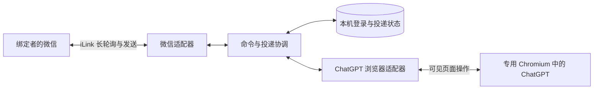

# 架构与扩展边界

第一版将微信协议、消息处理状态与 ChatGPT 网页适配分开。运行路径不依赖原 Dot 会话、Codex 桌面内部接口、个人隧道或公网 webhook。

## 模块职责

| 模块 | 职责 | 不能承担的职责 |
| --- | --- | --- |
| 微信适配器 | 扫码登录、校验绑定、长轮询、文字发送 | 按正文指定收件人、向其他联系人群发 |
| 命令与投递协调 | 区分命令和正文、选定会话、串行投递、持久记录状态 | 将输入中的普通文字当作管理权限 |
| ChatGPT 浏览器适配器 | 校验网页地址、保护草稿、提交一次、等待可确认的完成回复 | 处理验证码、复用个人主浏览器目录、使用隐蔽后台接口 |
| 本机状态 | 保存登录、选定会话、轮询与投递进度 | 作为可公开共享的调试附件 |

微信收发参考 [Tencent iLink Bot 协议](https://github.com/Tencent/openclaw-weixin/blob/main/docs/protocol.md)。ChatGPT 适配使用 Playwright 的[独立持久浏览器上下文](https://playwright.dev/docs/api/class-browsertype#browser-type-launch-persistent-context)，由用户自行登录。

## 一条消息的处理过程

1. 接收微信服务的更新，只接受扫码绑定者的完整单聊文字。
2. 通过原始消息标识检查重复投递。命令只匹配完整单行输入。
3. 在产生外部发送副作用之前持久记录投递意图。
4. 校验当前网页会话、空闲状态和输入框草稿，提交一次。
5. 确认新用户消息，再等待对应的新回复完成。历史回复不能作为本次结果。
6. 回传微信并记录结果。外部发送结果未知时保留不确定状态，不自动重发。

这些步骤旨在减少重复和错误关联，不构成“恰好一次”保证。网络断开或进程在临界点退出时，远端可能已接收消息而本地尚未获得确认。不确定状态只记录在原消息上，不自动重发；后续消息仍须通过网页会话、登录、空闲和草稿检查。进程重启会把未完成的提交保留为不确定记录，旧版的全局暂停字段会被移除，原投递记录不会删除。

## 功能范围

微信命令与已使用的 GPT 续聊范围对齐：`/help`、`/where`、`/list`、`/cd`，保留 `/switch` 兼容别名。列表最多 12 项；反复选择同一会话不重复导航。桥只接入已有普通会话，首页仅用于首次登录，不接受消息提交。

独立发行版保留扫码、专用浏览器、诊断和失效运行锁清理这些安装维护入口。它不包含私人部署的 Dot 路由、默认会话快捷名、主动提醒、HTML 预览或个人隧道，也不要求安装 Codex 或开启已有浏览器的调试开关。两者的底层接入方式不同，私人部署的可用性不能替代独立版真实账号验收。

## 为什么第一版没有通用插件框架

可替换的是渠道与聊天提供方的边界，第一版先验证一个完整组合。后续接入其他模型或渠道时，应保留以下约束：

- 账号与收件人的绑定由登录过程建立，不能从聊天正文更改。
- 接入器明确区分“尚未发送”“已接受”“结果未知”。
- 超时不会默认触发重复提交。
- 只提取本次可见最终输出；不混入推理、工具中间结果或旧历史。
- 测试使用模拟服务与合成页面，真实账号验收另行记录。

HTML 链接预览、图片/语音、多账号和主动通知均不属于当前 V1 支持范围。新增这些能力应单独说明数据去向、持久化和失败行为，不能只扩大原有文字接口。
